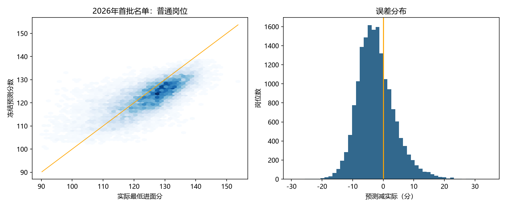

# 模型与评估边界

研究目标：报名开始前，基于岗位公开条件及此前年度结果，预测最低进面分。不是报名人数预测，不是个人上岸概率，也不是因果效应研究。

## 主版本与对照实验

| 版本 | 参数训练标签 | 历史特征标签 | 2026 的角色 |
| --- | --- | --- | --- |
| 冻结模型，主版本 | 2019—2025 | 预测时仅用截至2025的前三年内标签 | 仅独立检验 |
| 重训模型，对照实验 | 2019—2026 | 可用截至2026的此前三年标签 | 已进入开发数据，不能称独立测试 |

2027 主预测沿用冻结模型，也排除历史特征中的 2026 标签；并非只冻结模型参数，却让 2026 实际结果进入特征。
同一年标签不会用于当年特征，插补、缩放和类别编码只拟合训练集。不随机拆分岗位记录。
历史同部门/司局统计是同类分组均值，不代表跨年岗位已逐一匹配。

## 模型选择

2019—2022 训练检验2023、2019—2023 训练检验2024；按两年等权 MAE 选择。

| 模型 | 两年度平均 MAE |
| --- | ---: |
| 上年度同类别中位数 | 7.687 |
| 岭线性回归 | 8.086 |
| 随机森林 | 6.436 |
| LightGBM | 5.989 |

随后以2019—2024训练、2025作时间测试，普通岗位 MAE 4.952、RMSE 6.474、R² 0.498。
再以2019—2025的106,865条记录拟合原冻结模型。参数在读取2026实际结果之前固定。

## 2026 独立检验

首批名单20,227个岗位全部按键及名称匹配；487个预测岗位未出现在首批名单，不计入误差。

| 范围 | 样本数 | MAE | RMSE | 预测减实际平均偏差 | R² |
| --- | ---: | ---: | ---: | ---: | ---: |
| 全体混合口径 | 20,227 | 5.130 | 6.428 | -2.157 | 0.932 |
| 普通岗位 | 17,103 | 5.259 | 6.528 | -2.318 | 0.469 |

全体高R²包含分数口径组间差异，不能理解成普通岗位预测准确率93%。
普通岗位54.1%的绝对误差不超过5分，88.9%不超过10分。相比上年度同类别中位数基线（MAE 7.521）有改善，但不足以精确预测每个岗位。
检验后未据2026结果挑选主版本参数。后来重训的版本必须单独标注，原独立检验只属于原冻结模型。

## 局限

- 年度试卷难度、考生水平与报考选择可能造成整体偏差。
- 资格条件文本采用规则特征，未完成完整专业资格匹配。
- 备注长度可能吸收数据编排习惯，是代理特征，不能解释成因果因素。
- 特殊专业和非通用语岗位的分数口径及表现需要单独评估。
- SHAP解释模型贡献，不代表政策权重。
- 主版本预测2027时无法利用2026最新标签，这是保留其检验角色的取舍。
- 2027尚无真实结果检验，不能沿用历史MAE作为精度保证。
- 已发布预测的校验值证明文件版本，不能单独证明任何尚未保存的外部过程。
